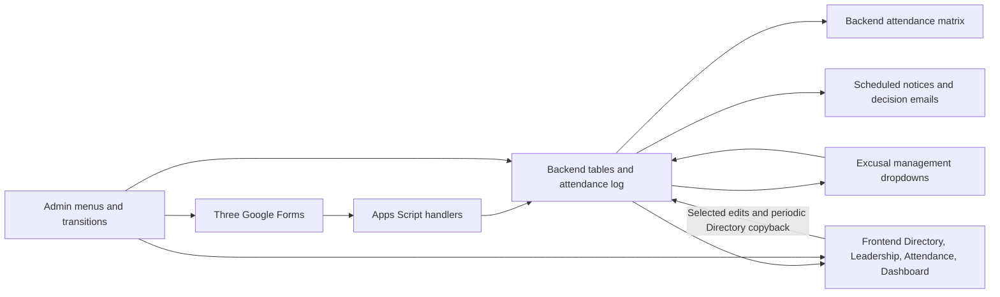

# SHAMROCK current-system audit for D1 redesign

Prepared 2026-11-05 from `dev` commit `d8cfc0171db772f8d5f5aff031eb7b3fda483676`. This is a source audit, not certification of the live deployment. No production records, permissions, delivery logs or resources were inspected or changed. Read with the [redesign plan](D1_REDESIGN_AND_MIGRATION.md) and [acceptance matrix](D1_FEATURE_PARITY_MATRIX.md).

**Current behavior is evidence, not a requirement.** Preserve detachment capabilities, applicable policy and historical evidence. Replace implementation defects and unnecessary complexity. Statements below describing what code does do not establish that it is desirable or mandated by regulation. Repository-relative `file:line` references identify the inspected baseline; they are not runtime evidence.

## 1. Architecture and data flow

The application is 16,915 TypeScript lines in 26 files, built as Apps Script V8 namespaces. `src/index.ts` contains callable entry points and menus; `services` mixes business rules, Google IO, rendering and orchestration. `forms/handlers.ts` parses submission events; `config/schemas.ts` defines physical sheet contracts; `utils` supplies table/header and option helpers. `package.json` builds with `tsc`; deployment runs build, copies the manifest, then `clasp push`. There is no Worker, SQL store or `doGet`/`doPost` HTTP interface today.

The graph is not a transaction: several handlers update a view before the durable log or send email among multiple independent writes. Backend authority is an intended convention; writable mirrors, direct log editing and repair paths make it difficult to enforce.

## 2. Canonical records and migration mapping

### Directory and Leadership

Directory has 20 fields (`src/config/schemas.ts:32`, `:141`). Preserve every value and its meaning, not its column letter:

| Fields | Proposed destination | Migration concern |
|---|---|---|
| `last_name`, `first_name`, `email` | people and identifier history | Email/name matches are current identity; duplicates and changes require a reviewed crosswalk |
| `as_year`, `flight`, `squadron`, `rank`, `role`, `flight_path_status` | term membership and role assignments | Preserve event-time and term-time context |
| `university`, `phone`, `dorm` | profile/contact fields | Phone is text; distinguish display formatting from stored identity |
| `cip_broad_area`, `cip_code`, `desired_assigned_afsc`, `class_year` | academic profile | CIP must remain text, including leading zeros; AFSC may not be a single normalized code |
| `home_town`, `home_state`, `dob`, `photo_link` | profile fields and resource reference | DOB is date-only; extract actual photo URI, not chip display text |

Current frontend accepts 16 fields: all except names, email and photo. Those 16 include rank, status and unit assignment; accepted edits do not prove all spreadsheet editors should control them. Actor/permission repair is required (`src/services/frontend-edit.ts:22`, `:103`).

Leadership has nine fields: `last_name`, `first_name`, `rank`, `role`, `reports_to`, `email`, `cell_phone`, `office_phone`, `office_location` (`src/config/schemas.ts:8`, `:189`). Manual/cadre contacts survive derivation. Records matching Directory identities are replaced by derived eligible command/advisor roles; this can discard manual edits to their other fields. Model assignments and manual contact information explicitly instead (`src/services/directory.ts:350`, `:454`).

### Events, attendance and excusals

| Current table | Complete field groups | Target/evidence handling |
|---|---|---|
| Events Backend | `event_id`, `term`, `training_week`, `event_type`, `display_name`, `attendance_column_label`, `expected_group`, `flight_scope`, `status`, `start_datetime`, `end_datetime`, `location`, `notes`, `created_at`, `created_by` | Stable events, aliases, applicability and creation provenance; preserve all 15 fields |
| Attendance Backend | `submission_id`, `submitted_at`, `event`, `attendance_type`, `email`, `name`, `flight`, `cadets` | Preserve grouped source row, source sequence and metadata; expand semicolon-separated cadet targets through reviewed mappings |
| Excusals Backend | `request_id`, `event`, `email`, `last_name`, `first_name`, `flight`, `squadron`, `status`, `decision`, `decided_by`, `decided_at`, `requested_outcome`, `attendance_effect`, `prior_attendance_code`, `submitted_at`, `last_updated_at`, `reason` | Preserve requests, decision/history snapshots, prior legacy effect and reasons; separate new adjudication from observation |
| Management projection | timestamp, decision, event, reason, requested outcome/Type, email, last/first name, flight, request ID | Rebuildable scoped projection and decision input; hidden request ID is the current join |
| Attendance matrices | names, AS year, flight, squadron, Overall %, LLAB %, dynamic event columns | Rebuildable output; retain legacy results as migration evidence and approved policy-versioned calculations |

Sources: `src/config/schemas.ts:214`, `:251`, `:293`, `:423`; `src/services/attendance.ts:18`, `:389`.

Audit has 30 fields: timestamp, result, severity, category, action/action label, actor email/key, role, target sheet/table/key/range, field, old/new values, event/request IDs, reason, notes, run ID, duration, source, version, error message/stack, metadata JSON, audit ID, spreadsheet ID/name. Preserve legacy audit records in restricted storage, including explicit unknown actors; do not fabricate attribution (`src/config/schemas.ts:317`, `src/services/audit.ts:91`).

Data Legend supplies 16 option ranges: AS_YEARS, FLIGHTS, SQUADRONS, CADET_RANKS, RANKS, HONORIFICS, UNIVERSITIES, DORMS, CIP_BROAD_AREAS, AFSC_OPTIONS, HOME_STATES, FLIGHT_PATH_STATUSES, ATTENDANCE_CODES, EXCUSAL_DECISIONS, EXCUSAL_STATUSES, EXCUSAL_REQUESTED_OUTCOMES. Code regenerates them; manual legend edits may temporarily propagate but later refresh overwrites them. The target needs one versioned option authority (`src/services/data-legend.ts:48`).

### Identity and ordering

There is no stable person ID. Directory upserts by email; Leadership falls back to names; attendance uses normalized first/last name and event text. Events have IDs but the log usually stores labels. Replay uses **physical log order**, not `submitted_at`; the last matching row wins, including a blank. Event matching differs in case sensitivity across paths. Keep this order only for exact legacy reconstruction. New observations/corrections need stable IDs, causal references and explicit policy (`src/services/attendance.ts:389`, `:417`; `src/services/excusals.ts:1340`).

Migration exceptions must cover duplicate names, changed emails, repeated cross-term event labels, duplicate submission/request IDs, unknown codes, invalid dates, orphan records and ambiguous raw responses. Every source occurrence receives a disposition; no silent name merge or dropped row. Classify historical evidence as reconstructable, snapshot-only or incomplete; overwritten decisions, best-effort audit and expired archives may make exact reconstruction impossible. Preserve recorded snapshots without fabricating the missing history.

## 3. Attendance and excusal behavior observed

### Roster, events and metrics

Inactive/Commissioned/Dropped are excluded from operational views; blank/unknown status is currently active. Canonical AS ordering is AS900, AS800, AS700, AS400, AS300, AS500, AS250, AS200, AS150, AS100, AF Civ. GMC includes AS100/150/200/250/500; POC includes AS300/400/700/800/900. These are recorded baseline rules requiring operational provenance where they affect eligibility/reporting (`src/utils/arrays.ts:7`, `:242`).

Matrix event ordering is training week, then Mando/Secondary/LLAB/Other, then source order. Third Hour is retired. Matrix construction does not filter event status and does not derive obligation or N/A from `expected_group` or `flight_scope`. Form choices likewise do not filter event date/status; notices do. This inconsistency should be resolved through typed events and explicit applicability, not preserved (`src/services/attendance.ts:70`; `src/services/forms.ts:236`).

| Current value | Numerator | Denominator |
|---|---:|---:|
| P, T, E, ES, MED | Yes | Yes |
| A, U | No | Yes |
| R, D, N/A, blank | No | No |

Zero denominator currently yields 100%. LLAB classification uses label text. Overall includes all matrix event columns. Dashboard averages person percentages, not pooled person-event credit. Preserve these as historical characterization; new code definitions and calculations must cite the actual applicable policy. Recommend explicit no-data state and typed event classification (`src/services/attendance.ts:46`, `:125`; `src/services/frontend-formatting.ts:1387`).

### Attendance intake and corrections

- Live form attendance writes P for selected cadets. It creates random IDs on each invocation and updates matrices before appending the backend log, allowing partial unlogged results (`src/forms/handlers.ts:257`, `:298`, `:322`). Native form/response identity should replace retry-unsafe IDs.
- Direct frontend event-cell corrections, including clearing a cell, are active features. The handler processes the top-left cell rather than a complete pasted range. Bulk fill offers flexible event/name/flight/university/AS selectors; cadet filters are ORed. Its frontend write uses backend positions, which is unsafe after sorting (`src/services/frontend-edit.ts:254`; `src/services/attendance.ts:189`). Keep corrections and reviewable bulk selection; replace positional writes.
- Backend log edits trigger full replay, despite immutable-log wording in docs. Future historical corrections must be explicit revisions, with original evidence retained and affected old/new targets recomputed (`src/index.ts:1267`).
- Attendance repair from raw responses matches email/event/timestamp, fills empty cadet lists and appends missing rows. It does not have guaranteed native response IDs. Use provenance and quarantine ambiguous historical correlations (`src/services/setup.ts:1301`, `:1531`).

### Excusal lifecycle

Each selected event creates a distinct request. Submission snapshots the current matrix code then appends R, even over P/T. Multiple requests for a person/event coexist without explicit case linkage. Prior snapshots can be stale (`src/forms/handlers.ts:411`; `src/services/excusals.ts:150`).

| Current decision | Current effect | Redesign implication |
|---|---|---|
| Approved | Requested P/T/E/ES/MED; invalid input defaults E | Validate instead of silently defaulting; distinguish correction from excusal adjudication |
| Denied | Current/prior P/T preserved; prior A/U becomes U; otherwise D before start, U at/after | Denial alone is not attendance evidence; finalization follows approved policy |
| Missing/invalid start time | Treated as started | Block adverse automatic finalization and request repair |
| Withdrawn/Superseded | Restore prior, except R/D becomes blank | Recompute current case/evidence; never overwrite newer truth with a stale snapshot |
| Unrecognized/no decision | R | Explicit validation and pending state |

Sources: `src/services/excusals.ts:40`, `:57`, `:1223`. Clearing a decision is ignored. Both management and backend decision handlers process multirow decisions; backend can force reapply unchanged values, management skips unchanged. Decisions, effect rows, email and audit are independent operations. New commands must atomically persist decision/audit/outbox and expose publication state.

Reconciliation preserves newer independent attendance/manual/new-pending entries, repairs missing/malformed same-decision effects using ID-prefix heuristics, and suppresses historical email. Replace heuristic effect linkage with explicit request/decision IDs. Keep source repair and reconsideration capability (`src/services/excusals.ts:1365`, `:1395`, `:1513`).

### Notifications

| Path | Observed behavior | Required redesign consideration |
|---|---|---|
| New request | Squadron commander To; cadet CC/reply-to | Confirm designated roles; keep missing-recipient exceptions visible |
| Decision/change | Cadet To; commander CC/reply-to, old/new wording when known | Configure fallback address; never copy a hardcoded personal address into generic source |
| Daily event | Hour 05, same-day active Mando/LLAB, flight scope; excused and pending lists | Preserve useful notice; clarify its meaning and completeness |
| Weekly closeout | Sunday hour 17, previous local Sunday–Saturday; blank→A, D→U, R unchanged; mail all A/U | Deadline/adverse inference needs policy; distinguish incomplete from final absence |
| Flight routing | Commander To/deputy CC; deputy primary if no commander | Typed role/unit routing and approved recipient policy |

Daily “all clear” only means no E/ES/MED and no pending request; it does not check actual attendance. Weekly “perfect” means no A/U, even with pending R. Replace misleading wording with factual counts. Sending failures currently warn and disappear; repeated runs can resend. Use durable pending/sent/failed/uncertain outcomes without claiming exactly-once external sending (`src/services/attendance.ts:629`, `:729`, `:843`, `:955`; `src/services/excusals.ts:92`, `:1683`).

## 4. Google workflows and presentation

### Forms

Three existing Forms remain useful intake surfaces; preserve URLs where practical. Directory uses collected email, supports response editing, profile validation and choice refresh. Attendance/Excusals disable response editing. The code attempts login requirements but actual verified-email configuration needs live validation. Unverified fallback text is not authentication (`src/services/setup.ts:1936`; `src/services/directory.ts:295`).

Attendance selection capabilities: Mando Alpha–Foxtrot plus separate Trine/Valparaiso groups, excluding Abroad and avoiding crosstown duplication; LLAB groups by flight including crosstown; Secondary excludes Abroad; Other includes active Abroad. Rosters group by AS year. Submit parsing infers type from label text, unlike the builder's event type. Stable question-role mappings plus immutable person/event choice references fix this; question IDs alone cannot identify string-valued checkbox choices (`src/services/forms.ts:663`; `src/forms/handlers.ts:261`).

Excusals select multiple events across category pages, then requested outcome and reason. Navigation placeholders must never become events. Repeated delivery currently makes new random requests. Use source identity and immutable payload fingerprints (`src/services/forms.ts:1005`; `src/forms/handlers.ts:348`).

Routine choice refresh retains question identities. Structural rebuild closes/unlinks, archives the old raw tab, rebuilds/relinks, then verifies a fresh response tab by ID. It may need asynchronous continuation; it preserves the Form's internal responses. Keep evidence and reliable dependencies, not accidental duplicate-question or relinking behavior (`src/services/setup.ts:2063`, `:2357`, `:2621`).

### Sheets, editing and views

The working frontend contains Dashboard, Leadership, Directory, Attendance; Data Legend and Dashboard Data are hidden. Source does not manage saved filter views. The user's Alpha view is live metadata requiring inventory, preservation or explicit migration.

Directory/Leadership/Attendance edits and the ten-minute Directory copyback make the frontend writable. The reconciler copies differing cells to the backend without versions. This must not survive as a D1 synchronization rule. Capture verified drafts/commands; repair displays from D1. Ordinary views continue to work without AI or a query per viewer (`src/services/frontend-edit.ts:360`).

Current formatting uses real Sheets Tables, two header rows, untyped columns, range-backed dropdowns, table add/read/update workarounds, archive-derived validation styling, photo smart chips and chart helpers. These are implementation observations. Preserve useful filtering, clear code/percentage display, working validation and links; change mechanics/layout where justified. Never add hidden IDs to the old “all columns after G are events” implementation without fixing every consumer (`src/services/setup.ts:414`; `src/services/frontend-formatting.ts:215`, `:405`, `:1647`).

Photo extraction checks rich-text links, linked runs, HYPERLINK formulas and raw URI. A display-value CSV loses that information (`src/services/directory.ts:118`). Formatted date/phone/CIP data likewise requires a typed export, not only displayed strings.

Dashboard capabilities: six navigation links; active/GMC/POC counts, Overall/LLAB means and below-80 count; four charts (AS-year comparison, term trend, flight comparison, AS-year roster); birthdays and code guidance. History selects current plus newest two exact term archives. Suffixed archive names can be missed; empty chart numeric series can throw. Preserve reporting outcomes and improve empty/history handling. Birthday visibility is an access decision, not justified merely by existing placement (`src/services/frontend-formatting.ts:1009`, `:1303`, `:1439`).

### Authentication and permissions

Current edit handlers ignore `e.user`; audit relies on active Session and can become `unknown`. `getAllowedEditors()` is unused in frontend edits. Protections are the main UI boundary and some errors are swallowed. These are defects to fix. Capture Google actor evidence; if missing, retain a draft and require authenticated confirmation. Never identify the trigger owner as the editor (`src/services/frontend-edit.ts:41`, `:72`; `src/services/audit.ts:61`).

Current protection groups derive administrators from backend editors and extra allowlist, and operational editors from Leadership. Directory body is broadly warning-only; Leadership/event cells admit operational editors. Management permits own-squadron Decision edits, with backend-admin preservation and role viewers. Do not grandfather accidental edit access. Define explicit capabilities and verify grants/revocations. Shared workbook protections restrict editing, not cross-squadron viewing (`src/services/protection.ts:190`, `:268`; `src/services/excusals.ts:926`, `:1891`).

## 5. Operations, transitions and recovery

Setup is extensive but not reliably idempotent on failure: general workbook/form open failures can create replacement empty resources; management failures may be swallowed. Distinguish absence, permission and transient errors; verify each required component (`src/services/setup.ts:44`, `:1888`, `:3517`).

Pause only gates selected edit propagation and Directory reconciliation. Form handlers, management edits and notice/closeout paths can continue. Replace ambiguous pause with explicit intake/processing/publication/mail maintenance states. A cutover needs all mutators fenced and in-flight executions drained (`src/services/pause.ts:6`; `src/index.ts:1164`, `:1362`).

Transitions collect a saved draft, archive previous state, alter Directory/logs/events/Leadership/management/forms, then reinstall triggers. Both kinds clear roles/flights/squadrons and reset ranks. Annual mapping currently advances 100→200, 150→250, 200/250→300, 300→400; original AS400 commissions unless overridden; AS500/AF Civ do not advance. Some dropped cadets still advance. Defaults are 16 weeks, first week 1/17, Mando Thursday 06:30, LLAB Tuesday 15:30. None is proven policy merely by this code. Replace with a reviewed next-term proposal, explicit status/role changes and versioned schedule configuration (`src/services/transition.ts:80`, `:532`, `:606`).

Continuation checks a four-minute cooperative budget, writes phase completion after external IO, and lacks a workflow-wide fence. A queued form finalizer can be treated as completed and then removed by trigger reinstall. Durable prerequisites, leases, receipts and recovery are necessary. Cleanup must retain snapshots needed by active jobs (`src/services/transition.ts:789`, `:906`).

Archives include protected values-only frontend term sheets, five temporary backend tables with seven-day expiry, management history in the admin workbook, and raw response archives. Existing non-menu generic archive/reset helpers replace fixed archives and can clear live sheets after copy failure; retire them in favor of tested snapshots/restoration (`src/services/setup.ts:694`, `:3435`).

CSV exports use exact machine headers and generic Date stringification. Imports trim cells; Events merge by ID then label, most others replace. Attendance import misses matrix rebuild; Directory import misses some dependencies; Events can refresh twice. New imports require versioned schemas, explicit modes, preview, stable IDs, dependency jobs and notification suppression. Preserve a legacy format only where a consumer needs it (`src/services/admin.ts:52`, `:157`).

Audit is best effort and catches its own write failures. Progress is per-user cache (six hours, 24 events), not durable workflow state. It distinguishes background in UI but menu wrapper can still log `ok` when child work is unfinished. Keep understandable progress and bounded polling; commit core audit with domain writes and report actual child completion (`src/services/audit.ts:91`; `src/services/progress.ts:8`, `:203`; `src/index.ts:96`).

Script Properties mix six resource references, editor allowlist, formatting toggles, pause, three form rebuild states, transition draft/state and archive registry. Separate deployment configuration from runtime state so a release cannot overwrite a live job (`src/config/properties.ts:4`). GitHub ownership does not transfer Google files, OAuth grants, trigger owners or Cloudflare ownership.

## 6. Complete menu disposition

All 49 `.addItem` registrations in `src/index.ts:245` are accounted for below. **Keep** means retain the capability, not necessarily the label; **consolidate** places it under a simpler control; **replace** changes flawed mechanics; **retire** removes a redundant/unsafe standalone control with the stated replacement.

| # | Existing group / label | Handler | Disposition |
|---|---|---|---|
| 1 | Setup & Automations — Run setup (ensure-exists) | `setup` | Replace: safe provisioning; fail on inaccessible configured resources. |
| 2 | Setup & Automations — Transfer to new semester (v2) | `transferToNewSemesterV2` | Consolidate: reviewed next-term roster/schedule plan. |
| 3 | Setup & Automations — Transfer to new academic year (v2) | `transferToNewAcademicYearV2` | Consolidate: next-term plan with explicit progression/status decisions. |
| 4 | Setup & Automations — Pause automations | `pauseAutomations` | Replace: separate intake, processing, publication and mail maintenance states. |
| 5 | Setup & Automations — Resume automations | `resumeAutomations` | Replace: verify health, drain safely, then resume selected domains. |
| 6 | Setup & Automations — Reinstall triggers | `reinstallAllTriggers` | Consolidate: adapter health and allowlisted trigger repair; retain jobs. |
| 7 | Sync & Refresh — Sync Directory to frontend | `syncDirectoryBackendToFrontend` | Consolidate: automatic dependencies and Repair views. |
| 8 | Sync & Refresh — Sync Leadership to frontend | `syncLeadershipBackendToFrontend` | Consolidate: role/contact projection repair. |
| 9 | Sync & Refresh — Sync Data Legend to frontend | `syncDataLegendBackendToFrontend` | Consolidate: versioned options publication. |
| 10 | Sync & Refresh — Sync all mapped tabs | `syncAllBackendToFrontend` | Consolidate: Repair views with scoped preview. |
| 11 | Sync & Refresh — Refresh Events artifacts | `refreshEventsArtifacts` | Consolidate: event dependency jobs and repair. |
| 12 | Sync & Refresh — Refresh Data Legend artifacts | `refreshDataLegendAndFrontend` | Consolidate: option/validation repair. |
| 13 | Sync & Refresh — Rebuild Dashboard | `rebuildDashboard` | Consolidate: report/view repair with empty-state support. |
| 14 | Sync & Refresh — Rebuild Attendance Matrix | `rebuildAttendanceMatrix` | Consolidate: recompute derived attendance under selected policy. |
| 15 | Sync & Refresh — Rebuild Attendance Form (archive responses) | `rebuildAttendanceForm` | Consolidate: safe form repair with preserved response evidence. |
| 16 | Sync & Refresh — Rebuild Directory Form (archive responses) | `rebuildDirectoryForm` | Consolidate: safe form repair with preserved response evidence. |
| 17 | Sync & Refresh — Rebuild Excusals Form (archive responses) | `rebuildExcusalsForm` | Consolidate: safe form repair with preserved response evidence. |
| 18 | Sync & Refresh — Refresh Excusals Form choices | `refreshExcusalsForm` | Consolidate: automatic event choice jobs and form repair. |
| 19 | Attendance — Fix Attendance headers | `fixAttendanceHeaders` | Retire standalone control: renderer owns schema/header repair. |
| 20 | Attendance — Fill Attendance event cells | `fillAttendanceEventPrompt` | Keep: reviewable bulk corrections with explicit target selection. |
| 21 | Attendance — Repair Attendance Backend from responses | `repairAttendanceBackendFromResponses` | Replace: source-response reconciliation, provenance and deduplication. |
| 22 | Attendance — Debug Attendance response columns | `debugAttendanceResponseSheet` | Consolidate: redacted health diagnostics. |
| 23 | Excusals — Setup management spreadsheet | `setupExcusalsManagementSpreadsheet` | Consolidate: provisioning and scoped projection repair. |
| 24 | Excusals — Share management spreadsheet | `shareExcusalsManagementSpreadsheet` | Consolidate: authorization repair and verified revocation. |
| 25 | Excusals — Reinitialize management sheets | `reinitializeExcusalsManagementSheets` | Consolidate: projection repair without losing draft input. |
| 26 | Excusals — Reconcile management decisions | `reconcileExcusalsManagementDecisions` | Replace: command/evidence reconciliation; stale cells are not commands. |
| 27 | Excusals — Debug Excusals response columns | `debugExcusalsResponseColumnsVerbose` | Consolidate: redacted health diagnostics. |
| 28 | Leadership & Directory — Add Leadership entry | `addLeadershipEntry` | Replace: structured role assignments and manual contact editing. |
| 29 | Leadership & Directory — Add Deputy Flight Commanders | `addDeputyFlightCommanders` | Consolidate: bulk role assignment for any role; no special name parser/default rank. |
| 30 | Leadership & Directory — Replay latest Directory form response | `replayLatestDirectoryFormResponse` | Replace: select and preview a source revision; avoid ambiguous latest replay. |
| 31 | Formatting & Protections — Apply frontend formatting | `applyFrontendFormatting` | Consolidate: view/layout repair with managed regions. |
| 32 | Formatting & Protections — Toggle frontend formatting | `toggleFrontendFormatting` | Replace: clear layout preferences and reset controls. |
| 33 | Formatting & Protections — Toggle column width formatting | `toggleFrontendColumnWidths` | Replace: width/layout preference independent of data updates. |
| 34 | Formatting & Protections — Reapply frontend protections | `reapplyFrontendProtections` | Keep: independently usable access repair and readback verification. |
| 35 | Formatting & Protections — Reorder frontend sheets | `reorderFrontendSheets` | Retire standalone control: layout repair manages ordering. |
| 36 | Formatting & Protections — Reorder backend sheets | `reorderBackendSheets` | Retire standalone control: admin-surface layout repair. |
| 37 | Imports & Exports — Export Cadets CSV | `exportCadetsCsv` | Consolidate: versioned dataset export; legacy format only for an identified consumer. |
| 38 | Imports & Exports — Import Cadets CSV | `importCadetsCsv` | Consolidate: roster import with explicit mode, preview and dependency refresh. |
| 39 | Imports & Exports — Export Leadership CSV | `exportLeadershipCsv` | Consolidate: contact/role export with ownership metadata. |
| 40 | Imports & Exports — Import Leadership CSV | `importLeadershipCsv` | Consolidate: contact/role import respecting source ownership. |
| 41 | Imports & Exports — Export Events CSV | `exportEventsCsv` | Consolidate: stable-ID event export with unambiguous dates. |
| 42 | Imports & Exports — Import Events CSV | `importEventsCsv` | Replace: stable-ID event import; reviewed aliases only for legacy inputs. |
| 43 | Imports & Exports — Export Attendance CSV | `exportAttendanceCsv` | Consolidate: observation/correction export plus legacy evidence option. |
| 44 | Imports & Exports — Import Attendance CSV | `importAttendanceCsv` | Replace: explicit evidence/correction import and recalculation; suppress historical mail. |
| 45 | Maintenance — Clean up script properties | `cleanupScriptProperties` | Retire misleading cleanup label: show configuration health without deleting runtime state. |
| 46 | Maintenance — Cleanup expired transition archives | `cleanupExpiredTransitionArchivesV2` | Replace: policy-aware retention that preserves active-job dependencies. |
| 47 | Maintenance — Dump structure to logs | `dumpShamrockStructure` | Consolidate: redacted support bundle. |
| 48 | Maintenance — Save structure snapshot to Drive | `dumpShamrockStructureToDrive` | Consolidate: protected support bundle, clearly distinct from backup. |
| 49 | Root — Show menu help / data flow | `showMenuHelp` | Keep: accessible operator help describing current authority and save states. |

## 7. Other callable functions and triggers

The source has 81 top-level functions in `src/index.ts`: the 49 menu handlers plus the following 32. This is an entry-point/reachability inventory, not a proposal for 81 API endpoints.

| Group | Functions | Target disposition |
|---|---|---|
| Seven UI helpers | `toast`, `errorDetails`, `menuActionStartDetail`, `confirmMenuAction`, `promptDriveFileId`, `runMenuAction`, `addShamrockMenu` | Keep useful adapter outcomes; not public application commands |
| Three open handlers | `onOpen`, `onFrontendOpen`, `onBackendOpen` | First two currently no-op; backend installs menus; redesign control placement for usability |
| Four continuations | `continueTransitionV2`, `finalizeAttendanceFormRebuild`, `finalizeDirectoryFormRebuild`, `finalizeExcusalsFormRebuild` | Durable job/dependency execution |
| Two schedules | `sendDailyEventAttendanceNotices`, `sendSundayAttendanceCloseout` | Deterministic schedule/window keys and approved policy |
| Three legacy schedule wrappers | `sendWeeklyMandoExcusedSummary`, `sendWeeklyLlabExcusedSummary`, `sendWeeklyUnexcusedSummary` | Retire once live trigger census proves no callers |
| Three form submits | `onDirectoryFormSubmit`, `onAttendanceFormSubmit`, `onExcusalsFormSubmit` | Authenticated idempotent source commands |
| Four edit/reconcile handlers | `onFrontendEdit`, `onBackendEdit`, `onExcusalsManagementEdit`, `reconcilePendingDirectoryEdits` | Verified draft/command capture and projection repair |
| Two progress transports | `runShamrockProgressAction`, `getShamrockProgress` | Bounded progress API with authorization and durable status |
| One repair | `repairExcusalDecisionAttendanceHistory` | Auditable evidence/derived-state repair |
| Two archive helpers | `archiveCoreSheets`, `restoreCoreSheetsFromArchive` | Retire unsafe generic reset; replace tested recovery |
| One header helper | `applyAttendanceHeaderFix` | Renderer/schema repair, not an independent operation |

Namespace utilities include extra CSV categories (`excusals`, `data_legend`), deep-clean/backlog and purge helpers. They are not registered menu requirements. The uninvoked excusal backlog parser differs from current Form headings and may send old mail; do not run it as migration machinery (`src/services/setup.ts:1124`). Source references for wrappers: `src/index.ts:162`, `:338`, `:376`, `:471`, `:570`, `:705`, `:884`, `:1009`, `:1164`, `:1335`, `:1485`.

| Canonical trigger | Source/schedule |
|---|---|
| `onDirectoryFormSubmit` | Directory Form submit |
| `onAttendanceFormSubmit` | Attendance Form submit |
| `onExcusalsFormSubmit` | Excusals Form submit |
| `onFrontendEdit` | Frontend edit |
| `onBackendOpen` | Backend open |
| `onBackendEdit` | Backend edit |
| `onExcusalsManagementEdit` | Management edit |
| `reconcilePendingDirectoryEdits` | Every ten minutes |
| `cleanupExpiredTransitionArchivesV2` | Daily hour 03 |
| `sendDailyEventAttendanceNotices` | Daily hour 05 |
| `sendSundayAttendanceCloseout` | Sunday hour 17 |

These are 11 regular triggers plus temporary transition/three form-finalizer triggers, scheduled at least 60 seconds later. Form finalization stops automatic retry after 15 attempts, retaining state for recovery. Timezone is America/Indiana/Indianapolis. Hour windows are not exact-minute promises (`src/services/setup.ts:1611`, `:1778`, `:1814`; `appsscript.json:2`).

Trigger reinstall deletes every trigger visible to its current user, catches some failures and can delete continuations. It cannot prove other owners have no triggers. Replace with allowlisted manifest reconciliation and database authority generations, backed by a real owner census.

## 8. Evidence gaps and implementation priorities

The 31 current local regressions cover selected email retries, pause, replay, form/roster ordering, sharing/protections, Directory refresh, decision repair and event refresh. They do not prove production UI, Forms settings, identities, mail delivery, complete transitions, CSV recovery or backups. Build/test success is a useful starting point, not migration acceptance.

Priority order:

1. Establish actual policy and deployed resource/owner baseline; inventory every live customization and writer.
2. Define stable identities, explicit authorization, observation/adjudication rules and safe draft editing.
3. Make command, audit and side-effect intent atomic; make retries and uncertainty visible.
4. Prototype real Google identity/edit/projection behavior and Worker Free CPU headroom.
5. Prove import accounting, historical reconstruction, improved outcomes, recovery and successor handoff.

Current docs sometimes describe a read-only frontend or immutable log despite active edit handlers; list frontend Events/Audit tabs not provisioned by current schema; and differ on dashboard dimensions. Resolve important workflow discrepancies through current production inventory and the redesigned contract. Do not perpetuate prose or code merely because it already exists.

Required live evidence: deployed commit, actual triggers/owners, resource bindings, Form stores and raw tabs, permissions and protected ranges, saved filters/tables/charts, archive formats, record counts/bytes, ambiguous identities, failed/pending jobs, sender quotas, institutional ownership and data-hosting approval. Store that inventory privately outside Git when it contains identifiers or personal records.
