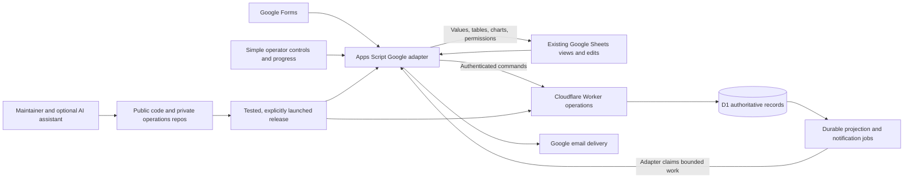

# SHAMROCK D1 redesign and migration plan

Status: proposed full design, with an isolated implementation started on 2026-11-05. Domain commands, D1 transactions, Google adapter contracts and fictional integration tests now exist. A Cloudflare staging Worker/database passed a fictional API smoke test and remains paused; no production migration or live Google workflow validation has occurred. See the [prototype runbook](../runbooks/D1_PROTOTYPE_RUNBOOK.md) and [staging runbook](../runbooks/D1_STAGING_RUNBOOK.md) for the implemented boundary. Shared service accounts and a private operations repository exist; remaining Google ownership/access and institutional deployment gates still apply.

Prepared: 2026-11-05. Source baseline: `d8cfc0171db772f8d5f5aff031eb7b3fda483676` on `dev`.

Read with:

- [Current-system audit](D1_CURRENT_SYSTEM_AUDIT.md): source evidence, existing rules, workflows, and discrepancies.
- [Feature-parity and validation matrix](D1_FEATURE_PARITY_MATRIX.md): required acceptance evidence.
- [Current system specification](../system/SYSTEM_SPEC.md): remains authoritative for the running v2 system until an explicitly approved cutover.

## 1. Decision and scope

Design a D1-backed SHAMROCK whose normal user interface remains Google Sheets and Google Forms. Attendance processing, filtering, percentages, approvals, synchronization, notifications, and scheduled work remain deterministic application code. No ordinary operation requires an AI model, AI subscription, AI API key, or available chat session.

AI is a maintenance assistant: it reads shared project context, explains the system, investigates authorized diagnostics, changes code and SQL migrations, and prepares tested releases. It does not calculate attendance by interpreting prompts or execute unrestricted SQL as the operational interface.

Use Cloudflare D1 for authoritative relational records, a small Cloudflare Worker for business operations, and Apps Script for Google-facing adapters. Keep the public application repository and a private operations repository under the detachment's GitHub organization. Design for GitHub Free and Workers Free; retain existing institutional Google Workspace services. No additional recurring subscription is assumed.

This is a conditional feasibility decision, not a promise of perpetual free service. Provider limits can change. Production eligibility requires measured capacity, demonstrated recovery, approval to host the relevant data in Cloudflare, and durable institutional account ownership. If a gate fails, keep the existing production system operating and resolve the design before migrating.

### Non-negotiable outcomes

1. A user can open Attendance and filter to Alpha Flight without AI or an API call for every view.
2. Forms and spreadsheet editing retain useful detachment tasks. Fields, prompts, permissions, layout, and maintenance controls may improve when their current shape has no operational rationale.
3. Directory, Leadership, Attendance, Dashboard, Data Legend, excusal queues, archives, CSV operations, notifications, and operator maintenance remain available.
4. D1 becomes the single authority only after a controlled cutover. Sheet projections can be repaired without replacing canonical records with stale cells.
5. The normal maintainer handoff requires organizational access and documented controls, not a production `.env` file.
6. No paid GitHub features, expiring student credits, paid model inference, custom domain purchase, always-on server, or managed database subscription is required for routine operation.
7. Preserve required operational outcomes and historical evidence. Fix engineering defects directly; record intentional differences so a comparison failure is explained. Current source is evidence, not the redesign's specification.

### Requirement provenance — current behavior is not automatically required behavior

The user's clarification on 2026-11-05 is controlling: keep spreadsheet-based answers, programmatic processing, useful detachment workflows, and rules grounded in actual operational/regulatory reasons. Replace weak implementation choices. This plan does not require preserving 49 menu labels, 81 global functions, hardcoded columns, unknown-actor audit records, misleading emails, or spreadsheet-based synchronization heuristics.

A search of tracked source/docs found no cited AFROTCI/DAFI/AFI document establishing the precise attendance calculation, deadlines, advancement defaults, or recipient policy. Two comments describe omitted submission receipts as “per policy,” but do not identify the policy. The current system spec records application behavior; it is not independent proof of a regulation.

| Basis | Treatment | Examples |
|---|---|---|
| Explicit user requirement | Required outcome | Sheets answer attendance questions through filters; Forms/edits process without AI; AI supports maintenance; free tiers and no env-file handoff |
| Detachment rule with identified authority | Encode and test against that authority | Attendance code meanings/credit, required participation, decision authority, notification recipients and deadlines |
| Operational capability inferred from current use | Keep the capability, improve its delivery; validate in operator rehearsal | Manual attendance correction, approving excusals in Sheets, roster changes, reports, term preparation |
| Engineering design or known defect | Redesign without seeking permission merely to preserve a bug | Stable IDs, transactional audit, authentication, retries, readable errors, safe imports, simplified repair controls |
| Unexplained policy-like behavior | Record a proposed outcome and obtain the missing operational rationale before production | Zero-denominator 100%, pending request masking attendance, automatic commission/year advancement, unknown event time becoming final absence |

Before implementation, each genuine business rule gets a policy ID, plain-language statement, source/owner, effective date, test fixtures, and affected outputs. A regulation reference should include the actual paragraph/version. Technical fixes do not need a separate business-policy approval. A changed attendance or eligibility interpretation does.

Feature parity therefore means no loss of needed capabilities or records, not identical bugs or pixels. Use three comparisons: lossless source accounting, characterization of old behavior, and acceptance against the new operational contract. Track explained differences in the matrix instead of forcing old wrong output to match.

### Evidence boundary

The audit covers checked-in source, schemas, documentation, package/manifest configuration, and the local regression suite. It does not certify the current production deployment, actual workbook contents, saved filter views, third-party scripts, account entitlements, Drive permissions, trigger ownership, record counts, or historical completeness. Those require a read-only production inventory in phase 0. No personal records, real resource IDs, credentials, or production exports belong in these documents or either Git repository.

## 2. Why change the backend

The current system contains 16,915 TypeScript source lines across 26 files. It already has useful domain services, stable headers, audit events, operator progress, repair routines, and regression tests. Preserve these investments.

The structural problem is that Sheets simultaneously holds canonical data, editable input, derived state, presentation, and recovery history. Services repeatedly identify records through names, emails, and event labels; rebuild matrices; and reconcile potentially stale mirrors. Large orchestration files combine business rules with Google API calls and dialogs.

The target moves identity, relationships, mutation ordering, constraints, and transactional writes into a documented data model. Google-specific rendering and input capture remain adapters. This improves maintainability without requiring users to learn a database interface.

Important findings that shape the plan:

- Frontend edits are real features: Directory has 16 propagated fields; Leadership supports edits; manual Attendance corrections include explicit blank clears.
- Legacy attendance replay follows physical log-row order. Preserve that order to reconstruct historical evidence and explain existing results; replace it with explicit observations, corrections, and policy in the new system.
- Pending and decided excusals interact with subsequent actual attendance and manual corrections. A simple priority ranking of attendance codes is insufficient.
- Current pause behavior is incomplete for migration purposes. Several submit, management-edit, and scheduled paths continue writing.
- Useful filtering, clear tables, validation, working photo links/charts, and legitimate access controls are part of feature parity. Their current API workarounds, pixels, and column positions are replaceable.
- Existing trigger reinstall, form-finalization, and transition workflows need explicit dependency and recovery handling.
- Some docs and labels describe broader behavior than their implementation. The audit identifies these cases separately from accepted requirements.

## 3. Target architecture



### Component responsibilities

| Component | Owns | Must not own |
|---|---|---|
| Pure domain package | Attendance reducer, excusal transitions, roster eligibility, role routing, term advancement, validation | Spreadsheet handles, HTTP requests, secrets, dialogs |
| Worker application services | Authentication/authorization, operation dispatch, D1 transactions, query pagination, job creation, health summaries | Google sheet rendering, unrestricted SQL endpoints, AI decisions |
| D1 repositories | Parameterized SQL, constraints, indexes, expected-version checks, durable job state | UI prompts or attendance policy hidden in ad hoc queries |
| Apps Script adapter | Verified form parsing, sheet edit capture, menus, Google resources, presentation, trigger execution, email delivery | Independent copies of business policy or permission rules that can drift |
| Google projections | Familiar tables, filter views, charts, exports, controlled editing surfaces | Unqualified authority to overwrite D1 after cutover |
| Private operations repo | Release manifests, internal procedures, configuration schema, handoff context, deployment/backup workflows | Plaintext credentials or live cadet datasets in Git history |

### Minimize services

Start with one production Worker and one production D1 database, plus isolated staging equivalents. Reserve a third temporary D1 database for restore rehearsals. Use the included `workers.dev` address; normal users continue using their existing Google URLs. Do not add R2, KV, Durable Objects, Queues, Workflows, a vector database, an AI gateway, or a browser chat application unless a measured requirement justifies it. R2 is object storage, not the relational database [P1].

The Google adapter initiates outbound requests to the Worker and claims work on a clock trigger. The Worker does not need to invoke Apps Script remotely or hold a Google user's refresh token for routine operation. This avoids making the Apps Script execution API a runtime dependency; that API has user-OAuth and Cloud-project requirements and does not support service accounts [P10].

Keep Apps Script runtime/services distinct from the optional Apps Script execution API. Form/edit/clock triggers can use `UrlFetchApp` to call the Worker, and the adapter can fetch pending Google jobs. Direct Sheets/Forms APIs remain available where useful. Script/API writes generally do not fire user-edit or Form-submit triggers, so every command must explicitly schedule its downstream publication, choice refresh and notification work; do not rely on an API write to invoke the next handler [P9].

## 4. Proposed relational model

This is a logical schema, not an executable migration. Phase 1 must finalize DDL, constraints, field mappings, and migration fixtures before production import. Use text identifiers for people, requests, events, and external references; do not cast identifiers into JavaScript numbers. Store instants in UTC and preserve the operational timezone `America/Indiana/Indianapolis`. Store birthdays as date-only values. Keep phone numbers and CIP codes as text.

| Entity | Main fields and keys | Purpose and constraints |
|---|---|---|
| `people` | `person_id`, names, current normalized email, version | Stable identity independent of name/email changes; approved merges are audited |
| `person_identifiers` | person, type, value, validity dates, source | Historical emails/names and verified login identities; ambiguous mappings are quarantined |
| `principals` / `access_grants` | Google subject or service identity, principal status; capability, unit/resource scope, effective interval, grant version | Separate authentication and authorization from display roles; revocation takes effect at command acceptance |
| `organizational_units` | unit ID, type, parent, display label, active interval | Stable flight/squadron identities for membership, routing and authorization; renamed units retain history |
| `cadet_profiles` | person, university, contact, dorm, CIP, AFSC, hometown/state, class, DOB, photo reference | Preserve all non-term Directory fields; sensitive field access is explicit |
| `terms` | term ID, label, dates, timezone, lifecycle | Active/closing/archived term; transition cannot silently change all historical records |
| `cadet_term_memberships` | term/person unique pair, AS year, flight, squadron, rank, role text, flight-path status, version | Preserve current roster behavior and term snapshots; explicit eligibility function |
| `membership_history` / `event_obligations` | person, effective interval, unit; event/person, required status, policy version | Preserve event-time context; distinguish required, optional, cancelled and not-applicable participation using the approved policy |
| `leadership_contacts` | contact/person, names, rank, role, reports-to, email, cell/office phone, office location, origin | Preserve manual/cadre contacts and derived-cadet distinction |
| `role_assignments` | person/contact, term, role kind, unit scope, source | Typed routing/protection roles with original display text; canonical squadron classification |
| `events` | stable event ID, term, week, type, display and column labels, expected group, flight scope, status, start/end, location, notes, creation metadata, version | Import every Events Backend field; renaming never changes identity |
| `event_aliases` | event, source, prior label, effective interval | Resolve legacy attendance/excusal text and preserve CSV/display compatibility |
| `source_submissions` | source/form identity, native response ID, revision, content hash, received time, submitter, state | Deduplicate response deliveries while retaining legitimate later changes |
| `form_catalog_versions` / `form_choice_references` | form/schema/catalog revision, item role, immutable choice token, person/event target, original label | Decode delayed responses without name guessing; question IDs identify questions, not selected entities |
| `legacy_attendance_entries` / `legacy_entry_targets` | source snapshot/row/order, original metadata/payload, reviewed person/event mappings | Lossless historical evidence and v2 reconstruction; no physical-row ordering dependency for new writes |
| `attendance_reports` / `attendance_report_members` | report/event, reporting scope, covered roster snapshot, reporter, partial/complete/amended status, completion time; member observations | Distinguish an incomplete presence list from an explicit complete group report, including zero attendees |
| `attendance_observations` / `attendance_revisions` | observation ID, event/person, observed/effective time, accepted sequence, correction-of, state, actor | Explicit attendance evidence, source corrections and tombstones; preserve blank versus absent versus not-applicable |
| `attendance_current` | term/event/person unique pair, observed state, obligation, adjudication, display code, metric eligibility, policy/version | Materialized result of the approved reducer with provenance; fully rebuildable |
| `excusal_cases` | term/event/person, current adjudication/version | Relate independent submissions and explicit amendments; never silently delete or merge legacy requests |
| `excusal_requests` | request ID, person/event/term, submitted roster snapshot, status, requested outcome, reason, prior code, version | Preserve every Excusals Backend field, including original dates and display snapshots |
| `excusal_decisions` | case/request/decision revision, decision, actor, time, superseded decision, policy version | Reconsideration history; the attendance reducer uses current adjudication alongside actual observations |
| `operation_commands` | command ID unique, payload hash, actor/source, result, committed sequence, schema version | Idempotency receipt and stable error/result reference |
| `intake_drafts` | draft ID, exact payload/hash, target/base versions, observed actor evidence, confirmation status, expiry | Bounded uncommitted input for trusted review; staging a draft grants no domain mutation authority |
| `audit_events` | audit ID, command/run, actor/source, action/result, target, old/new, metadata, timestamps | Transactional audit of mutations; preserve legacy audit fields in import mapping |
| `outbox_jobs` | job ID unique, type, aggregate/version, due time, lease, attempts, status | Durable projection, form refresh, sharing, and notification work |
| `notification_deliveries` | deterministic message key, recipients reference, state, attempt/ack times | Sending history and uncertain-delivery handling; recipient snapshots are access-controlled |
| `projection_checkpoints` | resource/projection, schema version, last applied sequence, source digest | Detect stale displays without treating them as fresh edits |
| `resource_bindings` | logical Google resource, external reference, deployment environment | Runtime configuration outside public Git; never used as bearer authorization |
| `workflow_runs` / `workflow_steps` | run, kind, term, frozen input snapshot, phase, lease, progress, result | Resumable setup, form rebuilds, archives, transitions, imports, and repairs |
| `migration_runs` / `legacy_record_map` | source snapshot/tab/row, target ID, hash, disposition, reviewer | Account for every imported, archived, duplicate, rejected, and unresolved row |
| `reference_options` / `policy_versions` | option set/key/value/order/version; policy version | Seed canonical arrays; drive Data Legend and Form choices consistently |
| `system_control` | authority mode, deployment generation, migration fence, pause domains | Explicit protection against old code or another owner writing after cutover |

Every existing schema field must have one of: a typed destination, a preserved source snapshot, a derived projection definition, or an explicitly approved removal. The default is preservation. Avoid an unstructured JSON-only database; bounded original-payload JSON is for evidence and mapping, not the primary query model.

### Constraints and indexes

- Enforce foreign keys and unique term/event/person current attendance records. Reject orphan events or people rather than creating guessed matches.
- Index event date/status/term, membership term/unit/status, requests person/event/status, legacy sequence and observation targets, outbox status/due time, and audit target/time. Validate query plans against populated staging.
- Define attendance and decision values from versioned canonical options. Preserve inactive historical values through a documented import path.
- Prefer explicit retirement and archival to cascading deletes. A person or event with attendance history cannot simply disappear.
- Use integer versions for optimistic concurrency. Define maximum payload sizes and reason/metadata storage rules without silently truncating existing data.
- D1 batches are transactional, but an UPDATE affecting zero rows does not itself throw. Version/authority preconditions must be asserted inside the same batch with a constraint-backed guard or an equivalently tested atomic pattern. Do not read a version in one request and assume it is still valid in a later write [P4].
- Do not assume arbitrary interactive SQL transactions across HTTP calls. Do not disable foreign-key validation as a migration shortcut; D1 provides deferred enforcement within transactions [P5].

### Legacy identity and replay ordering

Create a private, reviewable mapping before import. Map each legacy row using snapshot, sheet identity, row number, original submission/request ID, and content hash. These source references are provenance, not future primary keys.

Cadet names and emails may change or collide. Resolve verified IDs/emails first, then explicitly reviewed aliases. Never silently merge two people on a name pair. Event display names and attendance column labels are also aliases; classify ambiguous or duplicate labels before import. Unknown historical people/events remain represented as reviewed historical entities or unresolved records, not dropped rows.

Assign imported legacy entries a deterministic source sequence in original physical order, preserving timestamps independently. Use this to reconstruct what v2 displayed and diagnose discrepancies. Do not make future policy “whichever sheet row happened to be last.” New corrections reference an observation or decision explicitly, retain audit history, and recompute affected old/new person-event pairs. Where a legacy edit changes an old row's meaning, preserve its original slot in the legacy reconstruction, then derive the new outcome under the approved correction policy. New actual attendance and later adjudication must have explicit causal precedence.

Keep a bijective mapping from every old request ID and submission identity to its imported counterpart, except documented duplicate source IDs that require an additional occurrence key. Multiple cadets in one legacy attendance row become normalized targets without losing the original exported row representation.

Some historical evidence may no longer exist: decisions were overwritten, audit was best effort, and temporary backend archives expire. Classify each historical period/record as `reconstructable`, `snapshot-only`, or `incomplete`. Preserve archived results as recorded when their underlying evidence is unavailable. Never manufacture old membership, decision revisions or obligations from today's Directory. Keep original historical reports distinct from explicitly policy-restated reports; corrections to pre-cutover events must expose missing evidence and their documented basis.

## 5. Operation contracts and reliable execution

Expose named operations, not a public SQL endpoint. Initial families include roster/profile updates, leadership assignments, event changes, attendance submission/correction/log revision, excusal submission/decision, imports/exports, reconciliation, projection repair, setup, form refresh/rebuild, transition preparation/execution, and health inspection. The parity matrix maps the existing entry points to these families.

A mutation envelope carries a stable command ID, operation name and contract version, environment/generation, trusted adapter identity, actor evidence, payload, expected entity versions, and source metadata. A signed request timestamp limits replay of credentials; the durable command ID survives a retry with a new request timestamp.

Return a structured outcome: committed/rejected/conflict/deferred, command ID, committed version/sequence, safe message, and pending side effects. A timeout is an unknown outcome until the client checks the receipt. UI success must distinguish “saved; spreadsheet update pending” from fully published completion.

An initial transport contract can use `POST /v1/commands`, `GET /v1/commands/{id}`, scoped `GET /v1/projections/{kind}?cursor=...`, and trusted-adapter claim/acknowledgement operations for jobs. Read endpoints require authorization too. Large projection reads carry a stable generation/high-water mark; ordinary pagination cannot pretend to be a consistent snapshot while records change. Either publish a prepared projection generation or retry if its version changes.

Form command identity derives from source form, native response and permitted revision. A reviewed spreadsheet submission creates its command ID once and persists the exact payload in the private intake journal before HTTP delivery. A trigger ID or timestamp alone is not an edit identity. Large imports/bulk repairs use an explicit parent workflow and bounded atomic child chunks with target manifests, progress and resumability; do not claim the entire multi-request job is one transaction. Interactive commands must fit measured transaction limits or be routed through that workflow.

### Transaction boundary

1. Verify bridge authentication, source binding, authority generation, actor permission, payload schema, and limits.
2. Look up an existing receipt. Same command and same payload returns the prior outcome; reused ID with a different payload is rejected.
3. In one D1 transaction, assert preconditions, record the command, mutate domain records, append audit history, and enqueue side effects.
4. Return the receipt. A connection loss after commit cannot cause the domain mutation to repeat.
5. A trusted adapter claims bounded jobs with expiring leases, performs Google work, and acknowledges results. Failed jobs retain attempts, error category, and next retry time.

Use backoff with jitter and bounded attempts. Jobs exceeding the retry policy become visible “needs attention” work rather than disappearing. A time-driven adapter sweeps overdue jobs; immediate submit/edit executions may also claim their own small follow-up jobs for prompt spreadsheet updates. No paid queue is required initially.

Projection jobs normally mean “publish the latest desired state of this resource,” not “replay these old cell values.” Coalesce replaceable publications, serialize writers per Google resource, verify claim tokens/generation, and advance the checkpoint only after every chunk of a snapshot has been verified. A lease expiry cannot cancel a Google request already in flight: wait out the possible prior execution before takeover, detect uncertain writes, and repair from current desired state. Permission jobs reload current grants and prioritize revocation. Do not coalesce decision history, mail deliveries, or transition steps indiscriminately.

### External effects are not a distributed transaction

D1 cannot atomically commit a Sheets write or Gmail send. Sheet writes must be repeatable and version-aware. For mail, a crash after send but before acknowledgement creates an uncertain outcome. A deterministic notification key prevents duplicate enqueueing, but does not prove exactly-once delivery. Record `delivery_uncertain`, expose it for sender-side verification, and avoid blind resending. Only add automated sent-mail reconciliation if its additional Google scopes and privacy implications are approved and tested.

## 6. Preserve spreadsheet workflows

### Identity, tables, and filtering

Keep existing workbook URLs and saved filter functionality where practical so the migration does not break users' entry points. Inventory native tables, saved views, chart sources, links, validation and customizations in production. Preserve useful answers, legibility, discoverability, working photos/charts, and correct permissions. Two header rows, exact column order, widths/colors, hidden-column choices, archive names, and warning-only protections are implementation choices that may change through a documented UI migration. Test Alpha Flight filtering after refresh and roster changes; migrate user-created filters when the new schema moves fields.

Use stable row IDs in protected hidden metadata/helper columns that move with complete rows; use column metadata for stable event identity without changing visible event labels. Include helpers in safe sort boundaries. Prototype both table-filter sorting and manual range sorting: if a sort can detach identity from visible cells, reject/repair it rather than applying a change to a different person. Hidden sheets/columns are not confidentiality controls.

Keep resource/table IDs on ordinary value publication where possible. Retain current Google API workarounds only while they remain necessary for working Tables/validation/chips; verify a simpler replacement before removing them. Always use the actual photo URI, protect data after failures, and read back critical presentation/access results. Internal identity fields must be explicitly excluded from event-column enumeration; the old “everything after column G is an event” assumption must be removed.

### Edits and conflicts

Capture a permitted edit as a bounded command with stable row/event identity, the projected base version, changed fields, and verified Google actor evidence. Support deliberate bulk edits with per-record outcomes. Do not mistake a filtered row number for a database identity.

Separate user-owned draft input from system-owned recorded values. For excusals, keep an in-Sheets Decision dropdown as the input and show the recorded decision/save status separately. For roster/leadership/attendance corrections, use a controlled input region or a trusted editor reached from Sheets for selected records, including a reviewable bulk draft. This preserves spreadsheet tasks without requiring the same unsafe same-cell implementation.

Draft rows have immutable target identity and stable slots or live in a separate keyed draft table. A publisher must not change the name/hidden ID beside a pending draft, reorder just its neighboring output, or drop it when a cadet/request leaves the current view. Retain pending drafts until explicit resolution; move an entire bound record only under a tested protocol. Test publication, sort and roster removal between draft creation and submission.

Publishers must never overwrite draft input cells. `LockService` serializes scripts, not humans editing the UI; reading then writing a cell is not a safe compare-and-swap. Multi-cell edit events do not carry a complete immutable value snapshot. Capture/review bulk drafts before application, and do not attribute a later range read to a specific earlier editor. Track published base, draft, and current D1 versions:

- No draft: publish a newer D1 result to output cells.
- Draft exists and its base is current: authenticate, validate, persist the immutable command, then apply.
- Draft base is stale: preserve both values and flag a conflict; no automatic last-writer-wins guess.
- Draft and current D1 value already agree: report synchronized after checking the intended identity/version; do not manufacture a conflict or a duplicate mutation.
- Missed/ambiguous trigger: retain input for explicit authenticated submission; never infer human intent from an arbitrary stale mirror.

Fix the current failure to inspect `e.user`; use Google-supplied event identity and authorized session evidence appropriately. Google can still omit identity in some contexts [P8]. Test actual operator categories, including cross-domain users. When identity is unavailable, retain the in-Sheets draft and require trusted authenticated confirmation reached from the sheet. This is an implementation problem to solve, not a legacy behavior to preserve. Prove the chosen sign-in flow identifies each submitted command; do not assume one authorization permanently guarantees identity on every future edit trigger.

### Offline intake

Keep raw Google Form responses as the durable recovery source; use native response identity and payload revisions for replay. For sheet edits, keep a small private Google adapter journal of pending commands with hashes, versions, status, and limited payload. This journal is a transport buffer, not a second database. Restrict its workbook access, cap its retention, and reconcile it after outages. Script Properties and Cache are too small or ephemeral for a reliable bulk queue.

The sheet must visibly identify delayed/failed saves. Preserve the edit and show “pending” or a conflict note without representing it as committed attendance. Existing last-published views remain readable during an outage, with a freshness indicator. Do not silently activate a second spreadsheet backend when D1 is down.

## 7. Proposed operational contract

The audit describes the old system. This section describes the recommended replacement. Code meanings, participation requirements, decision authority, deadlines and recipient roles need the actual detachment policy identified in phase 1. Engineering defects do not become acceptance requirements merely because old code exhibits them.

### Attendance and excusals

- Separate **obligation**, **observed attendance**, **excusal adjudication**, and **display/metric result**. A submitted request is a request; it must not erase evidence that the cadet attended. A decision changes adjudication, and a correction explicitly changes an observation.
- Capture each group report's covered roster and whether it is partial or complete. Selecting present people alone is not proof that every other cadet was absent. Provide an explicit completion/zero-attendees path and amendments; overlapping reports need deterministic scope/correction rules. Only an authorized complete report or approved closeout policy can establish absence for unselected covered members. Old presence-only submissions retain unknown completeness.
- Keep familiar approved code labels and explanations. Record their policy version, numerator/denominator treatment, and effective dates. Preserve old calculations for historical reproduction; use the approved new policy for new outcomes. Recommend “— / No completed required events” for a zero denominator rather than an unexplained 100%.
- Derive obligation from the event's type/status, approved participation rules, and event-time membership. Cancelled, optional, out-of-scope, unreported and not-applicable are distinct states. Do not infer event type from a display-name regex or automatically penalize someone for an unknown timestamp.
- Pending requests appear alongside the recorded attendance; the matrix can display `R` where policy calls for it without destroying the observation. Denial does not itself prove nonattendance. Withdraw/supersede removes that request's effect and recomputes from current evidence, instead of restoring a stale saved cell.
- Keep every legacy request and decision. New amendments reference their case/request; conflicting concurrent requests require explicit handling. Approving requested `P`/`T` is an authorized attendance correction; `E`/`ES`/`MED` is adjudication. Confirm the authorized decision-makers and whether cadre determination is a separate step.
- Authorized users retain single and bulk corrections, explicit clears, reconsiderations, and historical corrections in Sheets. Revisions name what they correct and retain actor, reason, prior value and time. Historical repair never resends old mail or overwrites unrelated newer evidence.
- Closeout must distinguish unreported, pending review, observed absence and finalized unexcused absence. The deadline and responsible reviewer come from policy. Missing dates/identities block adverse finalization and create actionable exceptions.

### Directory, Leadership, events, and Forms

- Preserve all Directory information and useful roster/contact operations. Make enrollment eligibility, role assignments, ordering and event participation explicit. Unknown statuses become a review item rather than silently granting operational eligibility.
- Give self-service users only approved profile fields; give roster administrators enrollment, rank, unit and status controls. A current broadly editable cell is not proof of intended authorization. Manual/cadre contacts persist; cadet leadership derives from assignments, with editable contact details routed to their actual owning record.
- Keep Forms for verified directory updates, group attendance and multi-event excusal requests. Retain the required Mando/crosstown, LLAB, Secondary and Other selection capabilities, but simplify questions/navigation where it improves the task. Do not preserve duplicate-AS labels, mutable-name identity, or unverified-email fallbacks.
- Refresh choices in place. Structural rebuilds must preserve raw response archives and await verified fresh response destinations; scheduled finalization is a dependency, not completed work.
- Google Forms choices return their visible strings, without a separate hidden entity ID [P22]. Give person/event choices an immutable short reference suffix and persist its entity/catalog mapping. Keep labels readable and references nonsecret; never reuse a token for a different target. Item IDs identify question roles, response IDs deduplicate deliveries, and choice references identify targets. Decode delayed submissions against retained mappings, including duplicate names, renamed events and forms opened before refresh. Legacy tokenless answers require a reviewed crosswalk or quarantine.
- Preserve event identifiers, local date/time meaning, term/week context, one-off events, choices and attendance reporting. New exports have an explicit version and stable IDs. Keep a legacy CSV compatibility option only for a confirmed consumer, rather than freezing the physical sheet schema forever.

### Notifications and schedules

Retain useful event-day notices, weekly review, role-derived routing/CCs and request/decision notifications. Confirm actual recipient roles, local windows and submission-receipt preferences with the operational owner. The current 05:00 daily and Sunday 17:00 windows are baseline observations, not regulations. Apps Script time triggers are scheduling windows rather than exact-to-the-minute guarantees.

Use factual message wording. For example, “No recorded unexcused absences; 2 requests pending; 3 reports incomplete” is different from “perfect attendance.” Daily notices should describe excusals/availability and known incomplete data clearly. Correct misleading all-clear claims directly; only changes to the underlying attendance policy need policy validation.

Every scheduled command has a deterministic key based on task, local window, event/flight, and policy version. Replays and imports suppress outbound email unless explicitly requested. Notify only after the underlying transaction commits. Monitor recipient quota and backlog; do not switch to a paid mail provider implicitly.

### Semester and academic-year transitions

Retain term preparation, reviewable roster/schedule drafts, cancellation before application, history preservation and resumable execution. Present proposed changes person by person. Confirm AS progression, commissioning, rank and assignment changes explicitly or through an identified policy; do not automatically commission every old AS400, advance dropped cadets, or clear all assignments because the old script does so. Default schedules come from reviewed configuration, not hardcoded weekdays and week counts.

Implement a durable transition state machine with a term-scoped lease and authority fence. Each step has explicit prerequisites, a completion receipt, and a reconciliation check. Freeze the reviewed input before application; advancement applies once. A form rebuild returning a continuation cannot satisfy a dependent step until finalization completes. Trigger maintenance cannot delete live continuation work. Preserve accessible, protected term history and recovery snapshots; retention rules are separate from the current seven-day temporary-tab implementation.

Keep old and new transition entry points distinct during migration. The old transition cannot run against D1 authority. Do not migrate an active transition, unfinished form rebuild, or partially applied import; complete or explicitly recover it first.

### Admin operations and progress

Consolidate the 49 menu items into understandable controls: health/status, repair views/forms/access, attendance corrections, roster/role management, import/export, prepare next term, and maintenance/recovery. Preserve their useful capabilities, not every button or helper. Keep these deterministic controls available without AI. During migration, thin wrappers may bridge old entry points; retire them when their callers are migrated.

Retain audit, plain-language stages, prompts where needed, cancellation and durable resumability. The Apps Script adapter can reuse `runMenuAction(...)`; its name, cache design and polling intervals are not architectural requirements. Closing progress does not cancel server work. Status distinguishes accepted, waiting, partially published and complete; polling is bounded.

CSV imports become previewable, schema-checked jobs with explicit create/update/replace semantics, stable identifiers, row-level error reports, a frozen source file hash, and no automatic historical notifications. Replacement needs a reviewed scope and recovery point; label matching is not a general identity rule. Setup/repair must distinguish missing resources from permission or transient failures and must not create replacement production workbooks on an access error.

## 8. Access, ownership, and data boundaries

### Runtime trust model

Use a dedicated, institutionally approved standalone Apps Script project whose code editors are trusted maintainers. Spreadsheet editors must not automatically become script editors. Store a scoped bridge signing key in Script Properties and the corresponding Worker secret; rotate with an overlap window and key IDs. Sign method/path, timestamp, command ID, environment/generation, actor evidence, and body digest. Enforce TLS, bounded clock skew, source-resource allowlists, payload limits, and constant-time signature checks.

Separate automation hosting from UI hosting. Google documents custom menus as bound-script functionality [P21]; a trusted standalone adapter alone is not the menu/sidebar implementation. Start with ordinary links and, where useful, a minimal unprivileged bound launcher. It may identify a selected draft and open the trusted Worker-hosted review/sign-in page, but holds no bridge key, privileged Google token or authority to assert an actor. The trusted adapter can stage an uncommitted `intake_draft` from its private journal even when the original human identity is unavailable; this does not apply the change. The trusted page authenticates the confirmer, reloads the authorized draft and current target, and submits the exact reviewed hash/version. No Worker Google refresh token is needed to read the private journal. A managed add-on is a later option if an embedded editor materially improves usability. Phase 4 must demonstrate the actual UI/sign-in mechanism on institutional accounts, including restrictions on OAuth/add-on installation; do not assume it works from source alone. Normal identified excusal edits remain in Sheets; confirmation is needed when trustworthy actor evidence is absent.

HMAC authenticates the adapter, not the human. The Worker must independently enforce role/unit permissions using trustworthy actor evidence and the current authorization data. Never accept an arbitrary browser-supplied email, an unverified form field, or the trigger owner's identity as the human actor. Unknown actors cannot perform privileged actions. Recheck current permissions when applying delayed work; decide explicitly how revoked-user pending edits are handled.

Nominate initial administrators from a reviewed inventory of actual responsibilities and current ownership/permissions; do not automatically promote every legacy backend editor. Document group/domain resolution. Use explicit person/role/unit IDs, not substrings of leadership titles, for authorization. Keep deployment maintenance separate from operational data access. Synchronize role changes with Google sharing/protections and verify readback; a stale permission job must not re-grant a removed role.

Initial capability model: readers view permitted reports; cadets update permitted own-profile fields; roster administrators manage enrollment/unit/status; attendance representatives act for assigned units/events; decision-makers adjudicate their authorized scope; operations administrators handle broader corrections. Sensitive excusal details require separate read permissions. One shared workbook cannot enforce per-squadron row confidentiality merely with protected cells; if that confidentiality is required, use separate scoped workbooks/views.

The actor envelope records enrolled principal, observed email, evidence type, bound resource/trigger, observed time and operation scope. Google `triggerUid` identifies a trigger, not a unique edit. For authenticated confirmation, verify Google token signature, issuer, audience, expiry and session/CSRF protection; use Google `sub` for the durable login identity [P17]. Record the confirmer as authorizer rather than retroactively assigning the unknown original edit to them.

The Worker endpoint exposes only allowed operations and role-filtered results. D1 administrative tokens never reach spreadsheets or browsers. Maintenance SQL access is separate, scoped, audited, and unnecessary for ordinary operation. Public diagnostics contain only aggregates and safe status, not cadet identities or excusal reasons.

### Institutional handoff

The organization has at least two responsible owners. Google files, the automation execution identity, Cloudflare account, and recovery methods must be institutionally controlled. The SGA identity is acceptable only after confirming its account type, lifecycle, Workspace entitlement, and ability to authorize the script. A group mailbox is not assumed to be a runnable Google user.

Installable triggers remain owned by their creator and are not transferred by sharing a script [P9]. Maintain a trigger-owner inventory and a reauthorization/reinstallation procedure. Old owners must remove their own triggers; a new owner cannot assume their trigger listing is exhaustive. Use a database generation/lease check to neutralize old workers during handoff even if an old trigger still exists.

### Sensitive records

Obtain an institutional decision about which Directory, attendance, DOB/contact, excusal/medical, audit, and backup fields may be stored in D1. ND approval of one AI app does not establish approval of a third-party database or every AI client. Do not upload production records to test this design. If hosting approval requires keeping some fields in Google, document that split and evaluate its complexity before proceeding; it is not an invisible implementation detail.

AI context contains schemas, rules, synthetic fixtures, code, runbooks, and sanitized incident summaries. Production data and credentials require separate access. Exported backups remain in protected institutional storage, never public/private Git history or ordinary CI artifacts.

### AI assistance and knowledge handoff

Pass down **institutional ownership and versioned project knowledge**, not a personal chat's memory. Use individual maintainer logins with organization access and at least two custodians. A shared institutional automation identity may own Google execution where permitted; that does not require everyone to share a human GitHub or AI login.

Maintain a small context index linking the architecture, data dictionary, policy register, command catalog, feature matrix, local/staging setup, release/recovery runbooks, known limitations and sanitized incident decisions. Pin the deployed application/schema/adapter versions in the private operations repo. Update these documents in the same pull request as behavior changes. Optional generated context bundles should name their commit/date and exclude production records/secrets; a new assistant can load them without inheriting another person's conversations.

Notre Dame's student page currently provides Gemini App and Gemini Notebook access for students aged 18+, with institutional data protections when using the ND account [P18]. That establishes a useful question-answering/documentation option, not an entitlement for a custom agent to consume those quotas through arbitrary OAuth. Google documents separate API billing and product-specific developer benefits [P19]. Do not build a student-quota pooling service. Let each maintainer use an approved available AI client with the same repository context; verify that client's actual account entitlement before recommending it.

Do not base the plan on outdated free Gemini CLI/Code Assist individual login assumptions: Google's current deprecation notice says those consumer login routes stopped serving requests on June 18, 2026 [P20]. Powerful coding-agent availability at no cost is therefore optional and changeable; the application and handoff must work without it.

AI can prepare migrations, explain queries and propose fixes, but cannot substitute for demonstrated data integrity or an authorized release. Give it fictional fixtures and staging first; production diagnostic access is separately scoped and preferably read-only. Keep mutation controls deterministic and reviewable. An inexperienced successor should have guided health/repair controls and rehearsed runbooks, while at least one responsible maintainer remains able to review a release and restore a backup. SQL is manageable here; an unreviewed autonomous agent with unrestricted production SQL is not the maintenance model.

### Concrete chat options and MCP pilot

Google now documents custom MCP connections in Gemini web/mobile. Current eligibility requires a personal Google account, age 18+, US location, English and Keep Activity enabled; work/school accounts are excluded. Therefore this is a candidate for an individual maintainer's eligible personal account, not verified support for ND institutional Gemini. Personal-account handling does not inherit ND protections. No SHAMROCK account-level pilot has been completed [P23].

Expose a small authenticated MCP interface over the same deterministic operations, with tools such as reading project documentation, checking system health, inspecting permitted diagnostics and preparing a repair preview. MCP-user authorization is separate from the Google adapter's bridge key. Resolve the authenticated person to current SHAMROCK capabilities; an arbitrary email/tool argument cannot establish authority. Restrict returned data, require the exact reviewed payload for a mutation, and retain the normal command receipt/audit/retry behavior. Never expose unrestricted production SQL or make chat availability a prerequisite for a Form submission or spreadsheet decision.

An MCP connection supplies tools and context; it does not itself supply a code checkout, test runner or deployment environment. Feature development still uses a separate authorized development workflow with branches, fictional fixtures, tests and reviewed releases. Operational access must not automatically grant repository write or deployment access. Shared repository documentation and authorized retrieval provide continuity across chat accounts.

For a custom chat website, Google sign-in establishes identity; it does not by itself transfer the user's Gemini chat allowance to application API calls. API limits are project-based and the API has separate free/paid tiers [P24, P19]. If a custom site later proves worthwhile, a detachment-owned API project would avoid requiring every successor to maintain personal developer credentials. First verify actual free-tier availability, capacity and account-specific data terms, including product-improvement use; do not assume a consumer/API offering has institutional data protections. Model inference remains an optional, separately budgeted service.

Recommended sequence: build the shared operations and Google adapter; add a minimal MCP endpoint; test authentication, tool discovery, exact-action confirmation, revocation and quota exhaustion with fictional data in an eligible client; then decide whether a custom chat website offers enough benefit to maintain. Google's developer mode provides a documented test route [P25]. This pilot is an optional maintenance-interface milestone, not authorization to deploy or disclose production records. Data-hosting and AI-disclosure decisions remain separate from choosing D1.

## 9. Free-tier budget and operating limits

Verified against provider documentation on 2026-11-05. These are planning inputs; recheck before implementation/cutover and at each handoff.

| Service | Current allowance/constraint relevant here | Design response |
|---|---|---|
| D1 Free | 5 million rows read/day; 100,000 rows written/day; 500 MB/database; 5 GB/account; 10 databases | One active production database; indexes; bounded jobs; staging counts against the same account [P2, P3] |
| D1 recovery/SQL | Seven-day Time Travel on Free; 100 bound parameters/query; 30-second maximum query duration | Independent backups, small statements, incremental migrations; no unbounded query [P3] |
| Workers Free | 100,000 requests/day; 10 ms CPU/request | Small authenticated operations, incremental calculations, no model execution or giant replay in one request [P6] |
| GitHub Free organization | $12 included monthly compute usage for eligible private workloads; 500 MB artifact storage | Public standard-runner tests; short private deployment/backup jobs; minimal artifacts [P11] |
| Apps Script consumer / Workspace | 6 min/execution; 90 min / 6 hr daily trigger runtime; 20,000 / 100,000 URL fetches/day; 100 / 1,500 external email recipients/day | Confirm actual account; bounded executions; monitor recipient quota and retry backlog [P7] |
| Apps Script storage/triggers | 20 triggers/user/script; 9 KB/property value; 500 KB/property store; 50 MB URL-fetch response | Consolidate maintenance sweeps; durable queue outside properties; large backup streaming outside Apps Script [P7] |
| Sheets API | 300 read and 300 write requests/min/project; 60 each/min/user/project | Batch range operations, throttle per identity, back off on 429; avoid cell-by-cell writes [P12] |

Queries count scanned rows, not merely returned rows; indexes also consume write allowance. D1 Free rejects queries after daily limits are exhausted and blocks further growth at storage limits. Staying free means accepting a bounded outage instead of silently enabling billing [P2].

### Initial planning envelope — estimates, not measurements

Use 500 cadets, 200 events/year, and 250 inbound/edit commands on a busy day as a conservative synthetic workload. That is 100,000 person-event current records/year before log/audit overhead. Assume up to 40 database row writes per command including indexes and job acknowledgements: approximately 10,000/day, plus a 5,000-row reserve for scheduled work. Batch attendance commands must be charged by cadet target count; the per-command assumption does not cover a whole-wing import. Measure both peak event days and bulk operations.

Proposed steady-state budgets: less than 1 million rows read/day; less than 20,000 rows written/day; less than 10,000 Worker requests/day; p95 Worker CPU below 5 ms and no representative request reaching the 10 ms cap. A five-minute maintenance sweep is 288 calls/day. Public sheet viewing consumes none of these requests until the adapter refreshes data.

Storage must be measured from populated synthetic/imported staging, including indexes and revision history. At 1 KB per attendance-associated record, 100,000 records is already about 100 MB before other tables; multiple revisions can dominate. Set a 250 MB operational target, warning at 300 MB and a mandatory capacity/retention review before 400 MB. These are proposed controls, not a claim that the real dataset fits. Never delete required history merely to meet the budget.

Keep term history accessible in protected Google archives and verified exports. The retention owner must approve which historical rows can leave the online database and how retrieval works. If the approved retention and full-history query requirements do not fit one free database, evaluate a documented term-archive arrangement with restore support; do not silently shard or upgrade. Production cutover is blocked until a multi-year storage forecast fits the chosen policy.

### Avoid recurring charges

- Use standard public GitHub runners for tests containing only source and fictional data. Private CI covers credentials/deployment/backup work only. For illustration, 30 four-minute backups plus ten five-minute deployments use 170 Linux runner minutes/month; check the current runner rate and all other organization usage before relying on that estimate [P11].
- Keep repository-level secrets in the private operations repo. GitHub Free private repos cannot consume organization-level secrets, and private deployment environments require a paid plan. Do not depend on paid environment approvals or private branch governance being available [P13, P14].
- Restrict private write/admin access to trusted maintainers. Manual release initiation is a workflow convention, not a substitute for paid enforcement against someone who can change that workflow.
- Use no required R2 bucket, paid Access plan, custom domain, AI credits, paid email service, hosted development environment, or paid database add-on.
- Keep billable overage disabled/no payment method where supported and configure actual stop-spend controls for any account with billing. An alert alone is not a spending cap. Audit artifact/cache retention and account-level usage.
- Add a no-AI/no-GitHub-runtime outage test: existing attendance processing and views must continue if development tooling or student AI benefits disappear.

## 10. Repository structure and release process

Keep the current namespace-based Apps Script structure during the first extraction. Do not force Workers modules into Apps Script or refactor every file at once. Introduce a tested build boundary that compiles/bundles the pure TypeScript domain package for each supported runtime; prove output compatibility with Apps Script V8 before moving shared rules.

Suggested future public layout:

```text
packages/domain/          deterministic business rules and contracts
apps/worker/              authenticated commands, queries, D1 repositories
apps/google-adapter/      Apps Script entry points, menus, Google IO and rendering
database/migrations/     ordered SQL migrations
tests/fixtures/          fictional data and expected outcomes
tests/parity/            legacy/new differential tests and adapter contracts
docs/                    architecture, public workflows, generic maintenance
```

The private operations repo records the pinned public commit, Worker/adapter/API/schema versions, configuration names, institution-specific roles/procedures, deployment manifests, and runbooks. Resource IDs live in private repository variables/provider settings; tokens live in repository secrets/provider secret stores. CI generates `.clasp.json` and any temporary auth files only within the job. No maintainer needs to receive a production `.env` file.

### Release steps

1. Build and test a public commit; generate a versioned artifact and manifest without credentials/data.
2. Update the pinned version in the private repo and review the migration/compatibility notes.
3. Explicitly launch a private staging deployment against isolated D1, script, Forms, and workbooks.
4. Apply tested additive schema migrations; verify integrity, permissions, visual workflows, capacity, and recovery.
5. Explicitly launch production deployment after its gate is met. Confirm intended account/environment before secrets are used.
6. Record a recovery point and backup; deploy a backward-compatible Worker/adapter combination with an explicit contract-version handshake.
7. Run programmatic health checks plus the relevant spreadsheet smoke tests; record commit, schema, deployment generation, and result.

Credentials are configured once through provider/GitHub settings. Document renewal and rotation; stored secrets are not a readable backup vault. Apps Script deployment authorization remains a Google user-OAuth concern; do not promise service-account or GitHub-OIDC deployment without a verified supported mechanism [P10]. Prefer an approved institutional automation identity, not a departing student's personal token.

Release rollback and database rollback are separate procedures. Use expand/migrate/contract changes so a previous compatible application can run against the current schema. Do not drop columns or remove old read paths until the rollback window and data verification are complete. Deployment must never automatically reset or overwrite the database.

## 11. Migration phases and deliverables

| Phase | Work and deliverable | Exit evidence |
|---|---|---|
| 0 — Establish baseline | Read-only production census; ownership/permissions/trigger inventory; actual deployed version; workbook/tab/table/filter/form maps; data volumes; unresolved workflows; hosting decision | Baseline signed off; no unknown owner; no unexplained source/deployment drift; data-hosting approval and free account eligibility |
| 1 — Define operational contracts | Source genuine policy, complete capability matrix, characterize legacy output, specify improvements, finalize identity mapping and schema | Every needed capability has an owner/test; proposed rule changes and historical policy versions are explicit |
| 2 — Extract and redesign domain rules | Isolate legacy reference behavior; implement new pure reducers/routing/transitions under the approved contract | Legacy characterization tests pass; new acceptance fixtures prove intended outcomes; differences have reasons |
| 3 — Build D1 foundation | Worker authentication, commands, transactions, audit, schema, outbox, health, local/staging fixtures | Auth/permission/concurrency/idempotency tests; free CPU/query budgets measured |
| 4 — Build Google bridge | Versioned intake journal, projection checkpoints, safe edit capture, form parsing, controlled jobs, progress | Single-cell/paste/filter/sort/conflict/offline tests; authorized operators retain workflows |
| 5 — Import rehearsal | Export immutable snapshots to protected storage; map all rows; import staging in chunks; produce accounting and discrepancy reports | All records accounted for; authoritative identities resolved; reconstructable history reproduces; snapshot-only/incomplete history explicitly preserved; new-output differences explained; restore passes |
| 6 — Read-only shadow | Keep Sheets as authority; feed D1 shadow from immutable snapshots and captured changes; suppress all D1 external effects | At least one representative event cycle, a weekly closeout, a decision reconsideration and a transition rehearsal compare without unexplained differences |
| 7 — Cutover rehearsal | Practice write fence, drain, final delta import, routing switch, compatible release rollback and recovery | Timed runbook succeeds; controlled rollback retains every accepted command; catastrophic recovery respects stated backup RPO; legacy fallback only for tested representable states |
| 8 — Production cutover | Approved window; execute section 12; D1 becomes authority; preserve existing Google URLs where practical | Approved outcome checks, exact record accounting, valid permissions, no duplicate schedules/emails, healthy queues and free-tier headroom |
| 9 — Stabilize and hand off | Observe complete operating cycle; rehearse successor release and recovery; retire legacy writes only after sign-off | Another maintainer completes a synthetic fix, deploy, restore and owner-handoff exercise without a transferred env file |

Phase 6 shadowing is not dual authority: shadow D1 must never publish live cells, change sharing, or send mail. Avoid reconstructing all source data on each poll; capture a bounded change journal and periodic digest comparisons. The capture mechanism must include all legacy writers or explicitly freeze them during snapshots. Repeated polling alone does not prove that an intermediate historical edit was captured.

A one-workflow pilot demonstrates technical feasibility but does not authorize a partial production migration that loses other workflows. Prefer one complete authority cutover after domain and adapter parity rather than separate database ownership for interconnected Directory/Attendance/Excusals domains.

## 12. Production cutover runbook

This is a future execution procedure, not authorization to run it now.

1. Confirm approved release, actual operator account, protected backup location, capacity, completed staging rehearsal, and rollback support. Avoid an active event/closeout/transition window.
2. Capture the full pre-cutover resource manifest and a verified data/presentation snapshot, including filter views, table IDs, protections, form item/destination IDs, trigger owners, and active runtime state.
3. Establish a real write fence. Temporarily stop Form acceptance with a clear message; lock editable sheet ranges after saving the original protection configuration; disable legacy time writers/side effects under every known owner; put version-aware entry points into maintenance mode. Existing `PauseService` is not sufficient.
4. Wait for in-flight executions to drain and prove no continuing writes. Audit every mutator from the parity inventory. If a trigger owner or writer cannot be accounted for, abort the cutover.
5. Snapshot final source values and append-only capture evidence, then perform the final delta import using stable mapping keys. Review commands submitted just before the fence and late-arriving Google Form events; do not assume closing a Form cancels an execution already in flight.
6. Reconcile counts, target sets, legacy reconstruction, current attendance outcomes/percentages, pending/decided requests, Directory/Leadership, event columns, dashboard aggregates, scheduled recipients and archive manifests. Compare new results to the approved policy and documented expected differences. Unexplained differences block the switch.
7. Activate the new deployment generation and D1 authority together in the Worker and adapter. Deployments with an old generation refuse mutations. Keep legacy mutators disabled; only one scheduler/notification authority is active.
8. Publish initial D1 projections into existing Google resources with notifications disabled. Verify useful tables/saved filters, validation, photos/charts, draft/output separation and approved permissions under the new UI contract. Compare the published digest with canonical data.
9. Restore recorded Form open/closed states and intended input availability while retaining the newly approved permissions from step 8; do not restore legacy broad grants. Process buffered submissions through stable command IDs. Enable schedules after verifying their deduplication keys and next local windows.
10. Run controlled production smoke tests with authorized test records: Directory edit, attendance submission, explicit clear, excusal approval/reconsideration, filter view, and scheduled dry-run. Restore test records through audited actions.
11. Record the cutover receipt, exact deployed versions, counts, pending/uncertain jobs, and operator validation. Monitor queue age, failed saves, permissions, mail quota, D1 limits, and Worker CPU through the first complete event/weekly cycle.

## 13. Rollback and disaster recovery

### Before D1 accepts production writes

Abort and keep D1 shadow disabled. If Google surfaces are still v2-compatible, restore the original controls and verify the source snapshot before resuming. If cutover already changed layouts, schemas, draft regions, Forms, bindings or permissions, restore and validate the complete pre-cutover Google data/presentation/Form/resource manifest and a compatible v2 adapter before resuming. “No D1 writes yet” does not prove old handlers can safely run against changed Google surfaces. No translation is needed only when no incompatible surface or authoritative-state changes occurred.

### After D1 accepts production writes

Never simply restore old code or point users at an old spreadsheet snapshot. That would lose accepted edits and decisions.

1. Fence new writes in both systems and stop new side effects. Preserve Google intake journals and raw responses.
2. Export the current D1 state and command/audit history, record the last committed sequence, and capture external effect receipts.
3. Prefer rolling back to the prior compatible D1 application while retaining accepted records and current schema. Restore the database only when integrity requires it, then replay retained post-recovery-point commands safely.
4. A return to v2 requires a pretested reverse exporter and a specifically defined compatibility window. Reconstruct its tables/runtime state and prove every accepted command is represented. New obligation/observation/adjudication semantics may not fit v2; never flatten them silently or promise universal reverse compatibility.
5. If using that validated v2 fallback, restore execution with one trigger owner/scheduler and no historical mail resend. Reapply Google protections/Forms and reconcile pending input exactly once. Otherwise remain in safe maintenance mode while repairing/restoring the D1 system.
6. Keep the failed D1 deployment and exports protected for investigation. Record the rollback cause and every accepted command's disposition.

Decide before cutover whether a short v2-compatible pilot window is useful. If so, define and enforce its supported shapes, then explicitly end that fallback when introducing incompatible semantics. A redesign can proceed without universal v2 reversibility if compatible D1 rollback, independent restore and accepted-command recovery have been demonstrated.

### Backups and restoration

D1 Free has seven-day native recovery [P3]. Add daily verified exports and pre-release/pre-transition exports to a protected institutional Shared Drive. A private GitHub workflow can stream a D1 export to Drive using institution-controlled credentials; this avoids Apps Script's response-size/runtime limit. Use short-lived runner files and remove them; never upload production exports as ordinary CI artifacts or print signed download URLs/tokens.

Native D1 exports temporarily block database requests, so schedule an observed low-activity window and retain adapter input until queries resume. Do not claim a series of independently paginated SELECTs is a consistent snapshot. Export/import restrictions and size behavior must be tested on the actual schema; avoid virtual tables in the initial design [P15].

Proposed retention: 14 daily exports plus 12 monthly exports, subject to the approved data-retention policy and measured Drive capacity. Record schema/application versions, source sequence, table counts, integrity-check results, file hash, and restore instructions beside each backup. Keep historical term archives separately according to policy. Track export freshness from the Google health surface, because GitHub schedules are not a delivery guarantee.

At least monthly and before destructive schema changes, restore into an isolated database, verify counts/foreign keys/reducer output, and publish into isolated Google resources. Restore tests must disable notifications and sharing changes. Native Time Travel overwrites the database in place; capture the present state first and reconcile Google side effects and post-restore inputs before reopening service [P16].

Proposed recovery objectives, pending rehearsal: no loss of a command acknowledged as committed during ordinary transport failures; daily independent-export recovery point if native recovery is unavailable; restoration within one working day by a trained successor. External mail already sent cannot be undone. These are targets, not current guarantees.

## 14. Validation and release gates

The [parity matrix](D1_FEATURE_PARITY_MATRIX.md) is the release checklist. All critical paths need both automated and spreadsheet-level evidence.

- Differential tests: reconstruct exact legacy results from fictional snapshots; separately prove approved new cells, denominators, recipients, routing and transitions. Record deliberate differences; do not require the new reducer to reproduce known defects.
- Import accounting: every source row/response/archive has a mapped, preserved, duplicate, rejected, or unresolved disposition; unresolved authority/identity cases prevent cutover.
- Failure injection: timeout before/after commit, lost acknowledgements, duplicate triggers, two editors, old generations, stale projection writes, partial Google writes, expired leases, missing permissions, quota exhaustion, and uncertain mail delivery.
- Visual/interaction tests: native table/filter views, multi-row paste, manual attendance clears, smart chips, numeric charts, hidden archives, strict legends, and protection readback.
- Security tests: signature tampering, replay, forged actors, wrong environment, expired/revoked roles, cross-squadron edits, missing identity, public disclosure, and access-removal failures.
- Recovery tests: restore native/export backups, roll back compatible releases, test any promised legacy fallback, resume every transition phase, preserve late submissions, and prove no historical mail flood.
- Cost tests: simulated peak event/closeout/transition/migration workloads within budgets, including indexes, retries, shadow work, staging, CI artifacts and backup execution.
- Handoff test: a successor with their own accounts follows the documentation to diagnose a synthetic issue, make a small change, test, deploy to staging, restore, and rotate/reinstall automation ownership.

Build success alone is insufficient. The current 31 local regressions are an initial safety net, not production feature-parity evidence. Expand them around behavior before replacing adapters.

## 15. Decisions required before implementation advances

| Decision | Why it matters | Gate |
|---|---|---|
| Institutional Google/Cloudflare owners and approved recovery custodians | Automation must survive graduation | Phase 0 |
| Permitted D1 fields and backup storage | Includes sensitive excusal and contact records | Phase 0 |
| Actual users, records, archives, quotas and storage forecast | Free-tier fit cannot be inferred from source | Phases 0 and 5 |
| Actor identity for each real editor category | Google may omit identity; cannot safely guess permissions | Phase 4 |
| Actual code/credit, obligation, decision-authority, deadline, recipient and advancement policies | The repository does not establish regulatory authority for every current rule | Phase 1 |
| Historical retention and online-history requirements | Determines storage and recovery architecture | Phase 1 |
| Pending edits/conflicts UI and intake retention | Protect user intent during delay/outage | Phase 4 |
| Uncertain email delivery procedure | Exactly-once external sending is not guaranteed | Phase 4 |
| Rollback window and supported reverse-export shapes | Prevent accepted data loss | Phase 7 |

## 16. Implementation work packages

1. Baseline/export inventory tooling and private evidence format.
2. Golden fixtures and domain behavior tests, including deliberate defect dispositions.
3. Stable identities, typed schema, migrations, and import/reverse-export specifications.
4. Pure rule extraction with namespace-compatible build verification.
5. Worker command/auth/transaction/audit layer and health/usage reporting.
6. D1 outbox, leases, retries, projection versions, and uncertain-delivery state.
7. Google intake/edit-conflict adapter and projection identity prototype.
8. Domain-by-domain bridge implementation with consolidated operator controls and truthful progress.
9. Rehearsal importer, parity reports, shadow execution, and complete write fence.
10. Free-tier CI/deployment/backup workflows and durable account handoff.
11. Cutover, rollback, recovery and successor rehearsals.
12. Approved production migration, stabilization, then documented legacy retirement.

Each work package must update the relevant current spec/runbook/catalog when its behavior is actually introduced. This plan itself does not replace the running system's authoritative-backend invariant or authorize deployment.

## 17. Provider references

Checked 2026-11-05. Links support provider capabilities and constraints; architecture choices and workload estimates above are proposed SHAMROCK design decisions.

- P1: [D1 overview](https://developers.cloudflare.com/d1/) and [R2 overview](https://developers.cloudflare.com/r2/).
- P2: [D1 pricing and free-limit behavior](https://developers.cloudflare.com/d1/platform/pricing/).
- P3: [D1 limits](https://developers.cloudflare.com/d1/platform/limits/).
- P4: [D1 database binding and transactional batches](https://developers.cloudflare.com/d1/worker-api/d1-database/).
- P5: [D1 foreign keys](https://developers.cloudflare.com/d1/sql-api/foreign-keys/) and [migrations](https://developers.cloudflare.com/d1/reference/migrations/).
- P6: [Workers limits](https://developers.cloudflare.com/workers/platform/limits/).
- P7: [Apps Script quotas](https://developers.google.com/apps-script/guides/services/quotas).
- P8: [Google Session identity](https://developers.google.com/apps-script/reference/base/session) and [event objects](https://developers.google.com/apps-script/guides/triggers/events).
- P9: [Installable trigger identity and behavior](https://developers.google.com/apps-script/guides/triggers/installable).
- P10: [Apps Script execution API requirements](https://developers.google.com/apps-script/api/how-tos/execute).
- P11: [GitHub Actions billing](https://docs.github.com/en/billing/concepts/product-billing/github-actions).
- P12: [Sheets API quotas](https://developers.google.com/workspace/sheets/api/limits).
- P13: [GitHub Actions secret availability](https://docs.github.com/en/actions/how-tos/write-workflows/choose-what-workflows-do/use-secrets).
- P14: [GitHub deployment-environment availability](https://docs.github.com/en/actions/how-tos/deploy/configure-and-manage-deployments/manage-environments).
- P15: [D1 import/export behavior](https://developers.cloudflare.com/d1/best-practices/import-export-data/).
- P16: [D1 Time Travel and restore behavior](https://developers.cloudflare.com/d1/reference/time-travel/).
- P17: [Google ID-token verification](https://developers.google.com/identity/gsi/web/guides/verify-google-id-token).
- P18: [Notre Dame student AI resources](https://ai.nd.edu/essentials/students/).
- P19: [Gemini API billing](https://ai.google.dev/gemini-api/docs/billing) and [Google developer benefits](https://developers.google.com/profile/help/benefits).
- P20: [Google Code Assist consumer-account deprecation](https://developers.google.com/gemini-code-assist/docs/deprecations/code-assist-individuals).
- P21: [Google custom-menu hosting](https://developers.google.com/apps-script/guides/menus).
- P22: [Google Forms Choice values](https://developers.google.com/apps-script/reference/forms/choice) and [item response values](https://developers.google.com/apps-script/reference/forms/item-response).
- P23: [Gemini custom MCP apps and account eligibility](https://support.google.com/gemini/answer/17209137?hl=en-TT).
- P24: [Gemini API project-level rate limits](https://ai.google.dev/gemini-api/docs/rate-limits?authuser=77&hl=en).
- P25: [Gemini developer-mode MCP testing](https://developers.google.com/connected-apps/mcp/dev-mode/usage).
